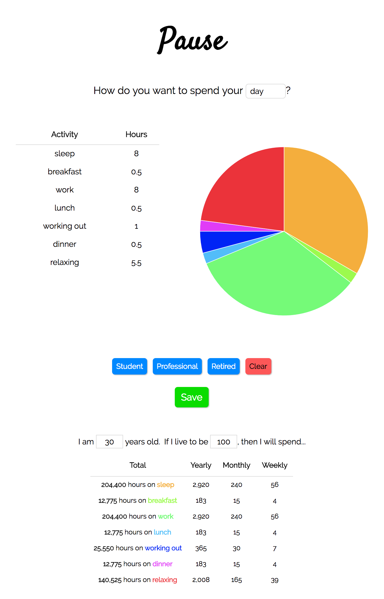

# Pause



Pause is a React app for planning how to spend a day, week, or month. Activities
are displayed in editable tables and Chart.js visualizations, with optional
shareable links, and optional Google sign-in for saved plans.

## Development

Requirements:

- Node.js 22
- npm 10 or newer

Set up and run:

```sh
npm install
cp .env.example .env.local
npx drizzle-kit push   # creates local.db
vercel dev --listen 5180
```

`vercel dev` serves the UI and the `api/` functions together; Vite alone
(`npm run dev`) serves no `api/`.

To sign in locally against production data, note that `vercel dev` loads the
project's Development env, and pause's variables are Production-only. Pull them
and export the app's own (never the `VERCEL_*` system variables, which break
routing), then delete the file:

```sh
vercel env pull .env.local --environment=production --yes
grep -v '^VERCEL' .env.local > .env.app && (set -a; . ./.env.app; set +a; rm .env.app; vercel dev --listen 5180)
```

`http://localhost:5180/api/auth/callback/google` is an authorized redirect URI
on the Google client. Pick the account within 15 minutes of clicking Sign in:
the PKCE cookie expires after that and the callback fails with `InvalidCheck`.

## Hosting

Vercel project `pause`, Turso database `pause`. The nightly backup runs through
`~/blob-backups`.

## Checks

```sh
npm test
npm run lint
npm run build
```

To inspect the production build locally:

```sh
npm run preview
```
